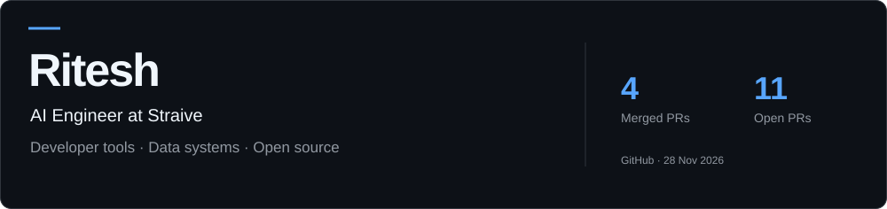

<picture>
  <source media="(max-width: 600px) and (prefers-color-scheme: dark)" srcset="./assets/hero-mobile-dark.svg">
  <source media="(max-width: 600px) and (prefers-color-scheme: light)" srcset="./assets/hero-mobile-light.svg">
  <source media="(prefers-color-scheme: dark)" srcset="./assets/hero-dark.svg">
  <source media="(prefers-color-scheme: light)" srcset="./assets/hero-light.svg">
  
</picture>

  <a href="#open-source">Open source</a> &nbsp; / &nbsp;
  <a href="#things-ive-built">Things I've built</a> &nbsp; / &nbsp;
  <a href="https://leetcode.com/u/Ritesh17rb/">LeetCode ↗</a> &nbsp; / &nbsp;
  <a href="https://www.linkedin.com/in/ritesh-kumar-b32a06251/">LinkedIn ↗</a> &nbsp; / &nbsp;
  <a href="mailto:ritesh17lifeamazing@gmail.com">Let's talk ↗</a>

## About

I'm an **AI Engineer at Straive**. Outside work, I build developer tools and contribute to open-source data systems.

Recent work includes RAG index auditing, schema validation for structured LLM outputs, and upstream contributions to Apache DataFusion Spark and Polars.

## Open source

My merged work in **Apache DataFusion Spark** includes Spark-compatible `timestamp_micros`, with input validation and coverage for integer boundaries, NULLs, and time zones. I'm also contributing to the **Polars R ecosystem**.

<!-- UPSTREAM:START -->
| Project | Contribution | Status |
| :--- | :--- | :--- |
| **apache/datafusion-spark** | [feat(spark): implement Spark-compatible lower and lcase · #398](https://github.com/apache/datafusion-spark/pull/398) | 🟢&nbsp;Open |
| **apache/datafusion-spark** | [feat(spark): implement Spark-compatible substring\_index · #397](https://github.com/apache/datafusion-spark/pull/397) | 🟢&nbsp;Open |
| **apache/datafusion-spark** | [feat(spark): implement Spark-compatible timestamp\_seconds · #396](https://github.com/apache/datafusion-spark/pull/396) | 🟢&nbsp;Open |
| **excalidraw/cli** | [fix: preserve Mermaid arrow gaps in the stable SDK · #16](https://github.com/excalidraw/cli/pull/16) | 🟢&nbsp;Open |
<!-- UPSTREAM:END -->

Latest public upstream pull requests · statuses refresh daily · <a href="https://github.com/search?q=is%3Apr+author%3ARitesh17rb+-user%3ARitesh17rb&type=pullrequests">View the full trail ↗</a>

## Things I've built

<table>
<tr>
<td width="50%" valign="top">
<h3>01 / <a href="https://github.com/Ritesh17rb/rag-audit">rag-audit ↗</a></h3>

Your source changed. Did your RAG index?

Find stale, orphaned, missing, and misconfigured chunks in an existing index.

<code>TypeScript</code> <code>RAG</code> <code>CLI</code>

<a href="https://www.npmjs.com/package/rag-audit">npm package ↗</a>
</td>
<td width="50%" valign="top">
<h3>02 / <a href="https://github.com/Ritesh17rb/schemaport">schemaport ↗</a></h3>

Switch LLM providers. Keep your schema guarantees.

Catch JSON Schema constraints that get lost when migrating structured outputs.

<code>TypeScript</code> <code>JSON Schema</code> <code>LLM tooling</code>

<a href="https://www.npmjs.com/package/schemaport">npm package ↗</a>
</td>
</tr>
<tr>
<td width="50%" valign="top">
<h3>03 / <a href="https://github.com/Ritesh17rb/skill-fit">skill-fit ↗</a></h3>

The right coding skills for the task at hand.

Prepare explainable skill sets for coding agents and record project verification.

<code>TypeScript</code> <code>Coding agents</code> <code>Developer tools</code>

<a href="https://www.npmjs.com/package/@ritesh17rb/skill-fit">npm package ↗</a>
</td>
<td width="50%" valign="top">
<h3>04 / <a href="https://github.com/Ritesh17rb/swiftcart">SwiftCart ↗</a></h3>

From a product idea to a working checkout.

A commerce app with payments, authentication, global state, and dark mode.

<code>React</code> <code>Node.js</code> <code>MongoDB</code>

<a href="https://swiftcart-two.vercel.app/">Live app ↗</a>
</td>
</tr>
</table>

More from the workbench: [devrun](https://github.com/Ritesh17rb/devrun) · [Verse Valley](https://github.com/Ritesh17rb/VerseValley) · [LynqIt](https://github.com/Ritesh17rb/LynqIt)

## Problem solving

[**LeetCode · Ritesh17rb ↗**](https://leetcode.com/u/Ritesh17rb/)

Problems solved by difficulty, ranking, and submission activity:

<a href="https://leetcode.com/u/Ritesh17rb/">
  <picture>
    <source media="(prefers-color-scheme: dark)" srcset="https://leetcard.jacoblin.cool/Ritesh17rb?theme=dark&amp;font=Roboto&amp;ext=heatmap&amp;border=0&amp;radius=12&amp;animation=false">
    <source media="(prefers-color-scheme: light)" srcset="https://leetcard.jacoblin.cool/Ritesh17rb?theme=light&amp;font=Roboto&amp;ext=heatmap&amp;border=0&amp;radius=12&amp;animation=false">
    
  </picture>
</a>

## The toolbox

| Where I'm working | What I reach for |
| :--- | :--- |
| Data systems & upstream patches | Rust · SQL · Python |
| Developer tools | TypeScript · Node.js · GitHub Actions |
| Full-stack products | React · Next.js · Express · MongoDB |
| Everyday engineering | Git · Docker · regression tests · a reproducible bug |

<strong>Background</strong>

Computer Science graduate from NIT Jamshedpur (2025). Previously an SDE Intern at Planful, contributing to GenAI features, localization, autocomplete, and admin dashboards.

---

**Have a bug worth chasing or a tool worth building?** [Let's talk ↗](mailto:ritesh17lifeamazing@gmail.com)
