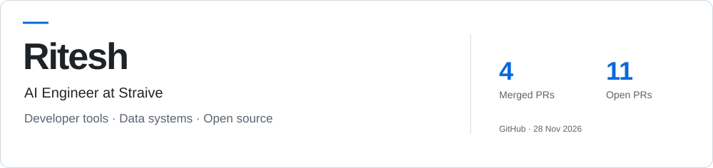
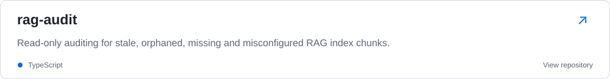
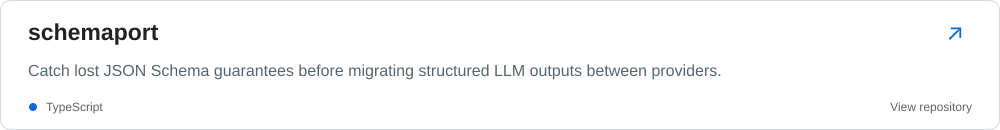
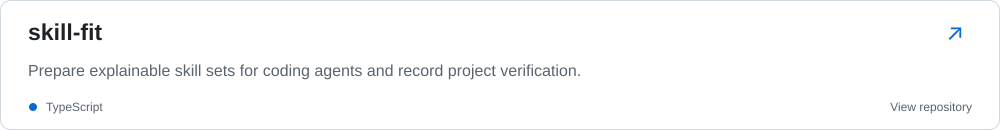
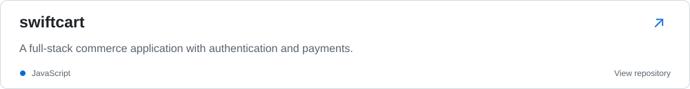

<picture>
  <source media="(max-width: 600px) and (prefers-color-scheme: dark)" srcset="./assets/hero-mobile-dark.svg">
  <source media="(max-width: 600px) and (prefers-color-scheme: light)" srcset="./assets/hero-mobile-light.svg">
  <source media="(prefers-color-scheme: dark)" srcset="./assets/hero-dark.svg">
  <source media="(prefers-color-scheme: light)" srcset="./assets/hero-light.svg">
  
</picture>

[LinkedIn](https://www.linkedin.com/in/ritesh-kumar-b32a06251/) · [Email](mailto:ritesh17lifeamazing@gmail.com) · [Open-source work](#open-source) · [LeetCode](https://leetcode.com/u/Ritesh17rb/)

I work on AI tooling and data infrastructure, from RAG index auditing and structured LLM outputs to Spark-compatible SQL functions. I contribute to **Apache DataFusion Spark** and **Polars**, and publish developer tools in TypeScript.

## Selected projects

<!-- PROJECTS:START -->

<a href="https://github.com/Ritesh17rb/rag-audit">
  <picture>
    <source media="(max-width: 600px) and (prefers-color-scheme: dark)" srcset="./assets/rag-audit-mobile-dark.svg">
    <source media="(max-width: 600px) and (prefers-color-scheme: light)" srcset="./assets/rag-audit-mobile-light.svg">
    <source media="(prefers-color-scheme: dark)" srcset="./assets/rag-audit-dark.svg">
    <source media="(prefers-color-scheme: light)" srcset="./assets/rag-audit-light.svg">
    
  </picture>
</a>

<a href="https://github.com/Ritesh17rb/schemaport">
  <picture>
    <source media="(max-width: 600px) and (prefers-color-scheme: dark)" srcset="./assets/schemaport-mobile-dark.svg">
    <source media="(max-width: 600px) and (prefers-color-scheme: light)" srcset="./assets/schemaport-mobile-light.svg">
    <source media="(prefers-color-scheme: dark)" srcset="./assets/schemaport-dark.svg">
    <source media="(prefers-color-scheme: light)" srcset="./assets/schemaport-light.svg">
    
  </picture>
</a>

<a href="https://github.com/Ritesh17rb/skill-fit">
  <picture>
    <source media="(max-width: 600px) and (prefers-color-scheme: dark)" srcset="./assets/skill-fit-mobile-dark.svg">
    <source media="(max-width: 600px) and (prefers-color-scheme: light)" srcset="./assets/skill-fit-mobile-light.svg">
    <source media="(prefers-color-scheme: dark)" srcset="./assets/skill-fit-dark.svg">
    <source media="(prefers-color-scheme: light)" srcset="./assets/skill-fit-light.svg">
    
  </picture>
</a>

<a href="https://github.com/Ritesh17rb/swiftcart">
  <picture>
    <source media="(max-width: 600px) and (prefers-color-scheme: dark)" srcset="./assets/swiftcart-mobile-dark.svg">
    <source media="(max-width: 600px) and (prefers-color-scheme: light)" srcset="./assets/swiftcart-mobile-light.svg">
    <source media="(prefers-color-scheme: dark)" srcset="./assets/swiftcart-dark.svg">
    <source media="(prefers-color-scheme: light)" srcset="./assets/swiftcart-light.svg">
    
  </picture>
</a>

<!-- PROJECTS:END -->

## Open source

Recent merged contributions and work in review, pulled directly from GitHub.

<!-- UPSTREAM:START -->
| Project | Contribution | Status |
| :--- | :--- | :--- |
| **pola-rs/r-polars** | [refactor: drop S7 0.x support · #1917](https://github.com/pola-rs/r-polars/pull/1917) | Merged |
| **pola-rs/r-polars** | [feat: add ewm\_sum expression method · #1915](https://github.com/pola-rs/r-polars/pull/1915) | Merged |
| **apache/datafusion-spark** | [feat(spark): implement Spark-compatible timestamp\_micros · #381](https://github.com/apache/datafusion-spark/pull/381) | Merged |
| **LibreChat-AI/LibreChat** | [fix: preserve literal dollar sequences in MCP placeholders · #18898](https://github.com/LibreChat-AI/LibreChat/pull/18898) | Open |
| **apache/datafusion-spark** | [fix(spark): use Spark field names in struct · #410](https://github.com/apache/datafusion-spark/pull/410) | Open |
| **apache/datafusion-spark** | [feat(spark): implement Spark-compatible lower and lcase · #398](https://github.com/apache/datafusion-spark/pull/398) | Open |
<!-- UPSTREAM:END -->

[All upstream pull requests →](https://github.com/search?q=is%3Apr+author%3ARitesh17rb+-user%3ARitesh17rb&type=pullrequests)

## Experience & education

**AI Engineer · Straive**

Previously an **SDE Intern at Planful**, working on GenAI features, localization, autocomplete, and admin dashboards.

**NIT Jamshedpur · Computer Science, 2025**

Working with Rust, Python, SQL, TypeScript, React, and Node.js.

---

Project cards and contribution counts refresh daily from public GitHub data. [How this profile updates](./scripts/update_profile.py)
